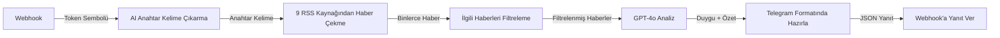

# 🤖 CryptoSentinel

> 24 saat nöbetçi kripto piyasa asistanınız

**CryptoSentinel**, GPT-4o yapay zekası kullanarak herhangi bir kripto token için gerçek zamanlı haber analizi ve piyasa duyarlılığı çıkarımı yapan tamamen otomatik bir n8n workflow sistemidir.

---

## 🎯 Ne İşe Yarar?

Manuel olarak saatler sürecek haber araştırmasını **30 saniyeye** sığdırır:

- 9 büyük kripto haber kaynağını aynı anda tarar
- Binlerce haber arasından ilgili olanları filtreler
- GPT-4o ile duyarlılık analizi yapar
- Telegram dostu formatta profesyonel rapor hazırlar
- 7/24 kesintisiz çalışır

**Tek bir mesaj:** `"BTC"` → **30 saniye sonra:** Tam piyasa analizi ✅

---

## ✨ Özellikler

### 🔥 Otomatik Haber Toplama
9 farklı kaynaktan anlık haber çekimi:
- 📰 **Cointelegraph** - En popüler kripto haber sitesi
- 📰 **Coindesk** - Profesyonel analiz ve haberler
- 📰 **Bitcoin Magazine** - Bitcoin odaklı içerikler
- 📰 **NewsBTC** - Güncel piyasa haberleri
- 📰 **Bitcoinist** - Derinlemesine analizler
- 📰 **CryptoPotato** - Trend haberler
- 📰 **99Bitcoins** - Eğitim ve haberler
- 📰 **CryptoBriefing** - Araştırma bazlı
- 📰 **Crypto.news** - Global kripto haberleri

### 🧠 Yapay Zeka Destekli Analiz
- **GPT-4o-mini** ile anahtar kelime çıkarma
- **GPT-4o** ile duygu analizi ve özet oluşturma
- Pozitif/Negatif/Nötr duyarlılık tespiti
- Doğal dil işleme

### ⚡ Hızlı ve Güvenilir
- Ortalama yanıt süresi: **30-60 saniye**
- Çapraz kaynak doğrulama
- Otomatik filtreleme
- Webhook tabanlı tetikleme

### 📱 Esnek Entegrasyon
- Telegram botları
- Discord botları
- API entegrasyonları
- Manuel webhook çağrıları

---

## 🚀 Kurulum

### Ön Gereksinimler

1. **n8n** kurulu olmalı ([n8n.io](https://n8n.io))
2. **OpenAI API Anahtarı** ([platform.openai.com](https://platform.openai.com/api-keys))

### Adım 1: Workflow'u İçe Aktar

1. n8n arayüzünüzü açın
2. **Workflows** → **Import from File** seçeneğine tıklayın
3. `Kripto Haber Analizi ve Telegram Bildirimleri.json` dosyasını seçin
4. Workflow otomatik olarak yüklenecektir

### Adım 2: OpenAI API Anahtarını Ekleyin

1. Workflow içinde herhangi bir OpenAI node'una tıklayın
2. **Credentials** sekmesine gidin
3. **Create New** → OpenAI API seçeneğine tıklayın
4. API anahtarınızı yapıştırın:
   ```
   API Key: sk-proj-xxxxxxxxxxxxxxxx
   ```
5. **Save** butonuna tıklayın

### Adım 3: Webhook'u Aktif Edin

1. **Webhook** node'una tıklayın
2. **Production URL** adresini kopyalayın:
   ```
   https://your-n8n-instance.com/webhook/a41af97d-6bd6-44d2-b79e-dca6df1e6e7e
   ```
3. Workflow'u **Activate** edin (sağ üstteki toggle)

✅ **Kurulum tamamlandı!** Artık sistemi kullanabilirsiniz.

---

## 📖 Kullanım

### HTTP POST İsteği ile

Webhook URL'inize POST isteği gönderin:

```bash
curl -X POST https://your-n8n-instance.com/webhook/a41af97d-6bd6-44d2-b79e-dca6df1e6e7e \
  -H "Content-Type: application/json" \
  -d '{"message": "BTC"}'
```

### JavaScript ile

```javascript
const response = await fetch('https://your-n8n-instance.com/webhook/a41af97d-6bd6-44d2-b79e-dca6df1e6e7e', {
  method: 'POST',
  headers: {
    'Content-Type': 'application/json',
  },
  body: JSON.stringify({
    message: 'ETH'
  })
});

const result = await response.json();
console.log(result.summary);
```

### Python ile

```python
import requests

url = 'https://your-n8n-instance.com/webhook/a41af97d-6bd6-44d2-b79e-dca6df1e6e7e'
data = {'message': 'SOL'}

response = requests.post(url, json=data)
print(response.json()['summary'])
```

### Desteklenen Token Formatları

Sistem doğal dil işleme kullanır, farklı formatlarda sorular sorabilirsiniz:

✅ `"BTC"` - Doğrudan sembol  
✅ `"Bitcoin"` - Tam ad  
✅ `"Bitcoin nasıl?"` - Soru formatı  
✅ `"ETH hakkında bilgi ver"` - Doğal dil

---

## 📤 Örnek Çıktı

```json
{
  "summary": "📣 BTC Duyarlılığı: POZİTİF 🚀\n\n📰 Haber Özeti:\nBitcoin 45.000$ direncini test etti. Kurumsal yatırımcılar alım yapmaya devam ediyor. SEC'in ETF onayı beklentisi piyasayı hareketlendirdi.\n\n💹 Piyasa Duyarlılığı:\nYükseliş beklentisi hakim. Analistler kısa vadede yukarı hareket öngörüyor.\n\n🔗 Kaynaklar:\n• Bitcoin hits $45k resistance - Cointelegraph (https://...)\n• Institutional buyers active - Coindesk (https://...)\n• SEC ETF decision pending - NewsBTC (https://...)"
}
```

---

## ⚙️ Özelleştirme

### Haber Kaynaklarını Değiştirme

Workflow içinde RSS Feed node'larını düzenleyerek:
- Yeni kaynaklar ekleyebilirsiniz
- Mevcut kaynakları kaldırabilirsiniz
- RSS URL'lerini güncelleyebilirsiniz

### AI Modelini Değiştirme

**Daha hızlı (ve ucuz) analiz için:**
```json
"model": "gpt-4o-mini"
```

**Daha detaylı analiz için:**
```json
"model": "gpt-4o"
```

### Çıktı Formatını Özelleştirme

**"İstem Oluştur"** node'undaki JavaScript kodunu düzenleyerek istediğiniz formatı oluşturabilirsiniz.

---

## 💰 Maliyet Tahmini

OpenAI API ücretlendirmesi:

| Model | Analiz Başına Maliyet |
|-------|----------------------|
| GPT-4o-mini | ~$0.001 |
| GPT-4o | ~$0.01 |

**Örnek:** Günde 100 analiz = ~$1 (GPT-4o ile)

> 💡 **İpucu:** Test aşamasında GPT-4o-mini kullanın, production'da GPT-4o'ya geçin.

---

## 🛠️ Nasıl Çalışır?



### Workflow Adımları:

1. **Webhook Tetikleme** - HTTP POST ile token sembolü alınır
2. **Anahtar Kelime Çıkarma** - GPT-4o-mini ile doğal dilden token ismi çıkarılır
3. **Haber Toplama** - 9 RSS kaynağı paralel olarak taranır
4. **Filtreleme** - Sadece ilgili haberler seçilir (başlık + içerik taraması)
5. **Prompt Oluşturma** - Filtrelenmiş haberlerden AI promptu hazırlanır
6. **Duygu Analizi** - GPT-4o haberları okuyup analiz eder
7. **Formatlama** - Sonuç Telegram dostu biçimde hazırlanır
8. **Yanıt** - JSON formatında geri döndürülür

---

## 🎯 Kullanım Senaryoları

### 📊 Day Trading
```bash
# Her sabah piyasa öncesi analiz
curl -X POST [webhook-url] -d '{"message": "BTC"}'
curl -X POST [webhook-url] -d '{"message": "ETH"}'
curl -X POST [webhook-url] -d '{"message": "SOL"}'
```

### 🤖 Telegram Bot Entegrasyonu
Kullanıcılar bota `/analyze BTC` yazdığında otomatik analiz gönderin.

### 📱 Discord Bot
Discord sunucunuzda `/crypto ETH` komutuyla anlık raporlar alın.

### 📈 Portföy İzleme
Portföyünüzdeki tüm coinler için saatlik otomatik rapor.

### 🔔 Alarm Sistemi
Belirli duyarlılık seviyelerinde bildirim gönderin.

---

## 🔧 Sorun Giderme

### ❌ "Credential not found" hatası
**Çözüm:** OpenAI API anahtarınızı tüm AI node'larına ekleyin.

### ❌ Webhook yanıt vermiyor
**Çözüm:** Workflow'un **Active** olduğundan emin olun.

### ❌ Çok az haber buluyor
**Çözüm:** Filtreleme kriterlerini genişletin veya daha fazla RSS kaynağı ekleyin.

### ❌ Yavaş çalışıyor
**Çözüm:** RSS kaynaklarını azaltın veya GPT-4o-mini kullanın.

### ❌ OpenAI rate limit hatası
**Çözüm:** API planınızı yükseltin veya istekleri yavaşlatın.

---

## 📚 API Kaynakları

### OpenAI API
- **Dokümantasyon:** https://platform.openai.com/docs
- **API Anahtarları:** https://platform.openai.com/api-keys
- **Pricing:** https://openai.com/pricing

### n8n
- **Dokümantasyon:** https://docs.n8n.io
- **Community:** https://community.n8n.io
- **Self-hosting:** https://docs.n8n.io/hosting

### RSS Kaynakları
Tüm RSS feed'leri ücretsizdir ve kimlik doğrulama gerektirmez.

---

## 🤝 Katkıda Bulunma

Bu proje açık kaynak değildir, ancak önerilerinizi ve geri bildirimlerinizi bekliyoruz!

**İletişim:**
- GitHub Issues
- Email: [buraya email ekleyin]
- Twitter: [buraya twitter ekleyin]

---

## ⚖️ Lisans

© 2025 **xCodeWraith (DEV)**. Tüm hakları saklıdır.

Bu sistem—iş akışı mimarisi, istem tasarımı ve mantık yapısı dahil—telif hakkı yasası kapsamında korunmaktadır. 

**İzin verilen kullanımlar:**
- ✅ Kişisel kullanım
- ✅ Eğitim amaçlı kullanım
- ✅ Özelleştirme ve geliştirme

**İzin verilmeyen kullanımlar:**
- ❌ Ticari yeniden satış
- ❌ Kaynak kod olarak dağıtım
- ❌ Lisans bilgilerinin kaldırılması

---

## 🌟 Teşekkürler

Bu workflow şu harika araçlarla geliştirilmiştir:
- [n8n](https://n8n.io) - Workflow automation
- [OpenAI](https://openai.com) - GPT-4o AI model
- Tüm açık RSS feed sağlayıcılarına

---

## 📞 Destek

Sorularınız veya sorunlarınız için:

1. Önce bu README'yi kontrol edin
2. GitHub Issues açın
3. Community forumlarına başvurun

**Mutlu analiz! 🚀📊**

---

<div align="center">

**[⬆ Başa Dön](#-cryptosentinel)**

Made with ❤️ by **xCodeWraith**

</div>
